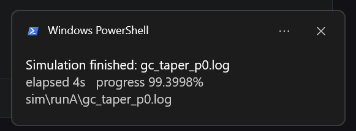

# sim-sentinel

One Windows scheduled task, one file-only state machine: read the engine log a simulation solver
writes itself, and raise **one** toast the first time a run is seen to finish, fail or stall.
Every verdict is appended to disk as a single JSON line, so "did it tell me last night?" has an answer.


[](https://github.com/55093693k-dot/sim-sentinel/actions/workflows/tests.yml)
[](https://doi.org/10.5281/zenodo.23817306)

**Who this is for.** Anyone running long local simulations — Lumerical FDTD or MODE, or any solver
that writes progress lines to a log — on a laptop, without a cluster and without wanting to install a
monitoring stack.

**What it does not do.** It does not query the solver, does not judge whether a result is converged,
energy-conserving or correct, and does not submit or cancel a cloud task. It answers one question:
*did the run finish, fail, or stop moving?*

## The problem

A three-dimensional FDTD run or an EME sweep usually outlasts the time a person can sit in front of
the screen. The solver offers no completion callback: it writes a log and exits. So the only fact
available is the log file, and the only useful behaviour is to watch it from outside.

## How it decides

Three rules; every line of code traces to one of them.

| Rule | Meaning |
|---|---|
| Evidence only | The tool never asks the solver anything. No log, no verdict. When it cannot read the process table it stays silent instead of guessing. |
| Transitions only | Each log file carries one state record, remembering the last announced state. One run produces exactly one notification, however often it polls. |
| Execution evidence, not echo | A printed "success", a fresh *Last Run Time* and an exit code of 0 are not evidence. A heartbeat timestamp, a product modification time and an append-only event record are. |

## Why the verdict is a pure function

`classify()` takes the log tail, the process state, the file size and the previous size, and returns
three things: the verdict, the updated stall counter, and **the evidence that produced the verdict**.
It does no I/O, reads no clock and mutates no state, which is why its tests run on any operating
system — no Windows, no PowerShell, no solver:

```
python -m unittest discover -s tests -v      # 14 tests, expected: OK
```

The two lists that decide everything are **data**, not code. `sentinel/config.json` may replace either
of them with whole regex fragments, so pointing the tool at another solver is a configuration change
rather than a code change:

```json
"done_patterns":  ["solver speed", "overall\\s+\\w+\\s+run time", "simulation completed"],
"error_patterns": ["^\\s*error\\s*:", "^\\s*fatal", "error code\\s+\\d+"]
```

When a verdict looks wrong, `--explain` prints the matching lines instead of asking you to believe it:

```
$ python sentinel/sentinel.py --explain D:\SimWorkbench\sim\runA\projC_p0.log
log      : D:\SimWorkbench\sim\runA\projC_p0.log
size     : 162  (previous -1)
alive    : False
verdict  : FAILED
  done    no closing summary line
  error   matched 'Error:'
  alive   False -- no engine process
```

Every raised event carries the same evidence in its `why` field, so `logs/events.jsonl` answers
"why did it tell me that" months later without rerunning anything.


## Quick start

```
<ROOT>\
├─ sim\                       engine logs, <project>_p0.log, scanned recursively
├─ sentinel\                  sentinel.py / toast.ps1 / config.json
├─ launch\                    sentinel_run.cmd / register_tasks.ps1
├─ logs\                      state.json / events.jsonl / toast.log / heartbeat
└─ _selftest_kit.ps1          end-to-end self-test
```

1. Copy `sentinel/config.example.json` to `sentinel/config.json` and set `root` to `<ROOT>`.
2. In `launch/sentinel_run.cmd`, set the interpreter on the `set PY=` line. Nothing may follow it on
   that line — `set` takes the rest of the line as the value.
3. `powershell -ExecutionPolicy Bypass -File launch\register_tasks.ps1` — add `-Preview` to see the
   configuration without registering, `-Remove` to unregister.

Three settings are not optional; drop any one and the task "looks like it is running" while doing
nothing:

| Setting | Without it |
|---|---|
| `-AllowStartIfOnBatteries` / `-DontStopIfGoingOnBatteries` | On a laptop it stops triggering once unplugged, silently |
| `-MultipleInstances IgnoreNew` | One wedged instance makes every later trigger be dropped silently |
| `-ExecutionTimeLimit <finite>` | The default limit is 72 hours, so a wedged instance never frees itself |

## What you see

One toast:

```
Simulation finished: gc_taper_p0.log
elapsed 41m 07s   progress 99.4%
sim\gc_taper\gc_taper_p0.log
```



> *How the toast looks on the machine named in the test: title line = verdict + log file name,
> second line = elapsed time and the last progress value, third line = the log path. The sender is
> shown as Windows PowerShell because the tool reuses that built-in app identifier — nothing is
> installed or registered.*
>
> *What the image does not show: it came from a manual poll of a demo directory, not from a scheduled
> trigger; `elapsed 4s` is that demo run, not a typical FDTD run; and no judgement about the physics is
> implied — the tool reports state transitions only. Whether a toast is visible still depends on the
> system's notification settings.*

One line of evidence, appended, never rewritten:

```json
{"ts": "2026-10-29 17:34:52", "kind": "FINISHED", "log": "sim\\gc_taper\\gc_taper_p0.log",
 "pct": "99.4%", "last": "total FDTD solver speed on 10 processes (Mnodes/s): 214.5", "toast_rc": 0}
```

The two strings are built in `poll()`: the verdict word changes with the state, the rest is fixed, so
translating the toast is a one-line edit. Nothing else in the tool is language-dependent.

Two counter-intuitive facts live in the verdict vocabulary; read the comment block at the top of
`sentinel/sentinel.py` before changing it. `Auto Shutoff` is an automatic-shutoff *threshold* printed
on every progress line, not a completion marker. And the closing summary line of a finished run may
sit at 99.4%, so "wait for 100%" is not a criterion either. Error words are matched anchored
(`^\s*error\s*:`) because ordinary log prose contains "error" and "cannot" as well.

## Verify it yourself

```
powershell -ExecutionPolicy Bypass -File _selftest_kit.ps1
```

It copies the kit into a temporary directory, builds four fake logs, runs the sentinel ten times in
order and asserts "silent when it should be silent, one notification when it should report". The
sandbox is deleted afterwards (`-Keep` keeps it); no toast is shown and no real state is touched.
When the `tests/` directory is present it also runs the pure verdict tests first. Expected output:

```
--- verdict tests ---
OK
PASS  finished log, FIRST sight -> silent baseline   expect=0 got=0
PASS  same log again -> still silent (dedupe)        expect=0 got=0
PASS  progress only -> no verdict                    expect=0 got=0
PASS  error appears in same log -> FAILED fires once  expect=1 got=1
PASS  FAILED again -> deduped                        expect=1 got=1
PASS  unchanged size x3 polls -> STALLED (4th run)    expect=2 got=2
PASS  pause marker -> polling skipped                 expect=2 got=2
RESULT: ALL PASS
```

## Readings

Each number carries the conditions it was taken under; without them the number means nothing here.

| Quantity | Reading | Conditions |
|---|---|---|
| verdict-rule cases | 6/6 pass | 2026-09-26, one machine |
| replay of real logs | 77 logs → FINISHED 68 / FAILED 1 / UNKNOWN 8 | same day, one-off re-judgement of that work tree |
| logs covered per poll | 503 files | health report of 2026-10-22 09:15 |
| heartbeat continuity | 13 consecutive minute timestamps (15:22:02 → 15:34:02) | that machine, unattended |
| end-to-end self-test | 7/7 assertions | 2026-10-29 and 2026-10-31, temporary directory |
| verdict unit tests | 14 pass | 2026-10-31, local Python 3.13; the same command runs in CI on Ubuntu for 3.10 and 3.12 |
| wedged-task fingerprint | `State=Running` + `Last Result=267009` | 0x00041301, an instance still running |

## Limitations and known defects

- **Windows only.** The application identifier, the task scheduler and the process list are Windows
  features. On Linux the state machine and the verdict vocabulary carry over unchanged; `cron` and
  `notify-send` replace the two outer layers.
- **Local logs only.** A cloud job (Tidy3D, for example) writes its log elsewhere, and needs a separate
  read-only poller: query task status, never submit or cancel, keep credentials in a local file outside
  any repository. This repository does not contain that channel.
- **It does not judge the physics.** "Did it finish" is a different question from "is the result right".
- **First-sight silence has a cost.** If a run finishes between two polls and its log is then removed,
  that notification never arrives. One-minute polling plus a fifteen-minute window makes this
  unlikely, not impossible.
- **No scheduled task is registered by this repository.** The tool ran for real on one Windows machine
  between September and October 2026; this repository is a rebuild that can be re-run — every path
  comes from `config.json`, so moving the directory no longer breaks it. The historical version kept
  paths in constants and died when the folder moved.
- **Whether a toast is visible depends on system settings.** Focus assist, the per-sender switch and
  policy can all swallow it. The tool can record "the call succeeded"; it cannot record "a person saw it".

## Cloud solvers (Tidy3D and similar)

This tool watches a **local** log file. A cloud job does not write one: the solver runs on the
provider's side, and the local process only shows a progress bar. In tidy3d 2.11.2 — read from the
installed package, not from a run — the client's console output is a rich progress task, and the
authoritative state is the task's `status` field (`queued → preprocess → running → postprocess →
success / error`), reachable only through the SDK, with an API key.

So for a cloud run the honest options are:

1. redirect the client's output to a file and point `log_glob` at it — workable, but you are parsing a
   progress bar rather than a log line, so the vocabulary is fragile;
2. poll the task status read-only through the SDK — the right signal, but it needs the `tidy3d`
   package and a credential, which is exactly what this repository is built to avoid.

This repository ships neither. What it contributes is the state machine: five fields, first-sighting
silence, a stall criterion, one notification per transition. All of that ports to a status poller
unchanged. Whether such a port should exist is a fair question, and the answer belongs to whoever
would use it.

## Troubleshooting

| Symptom | What it means |
|---|---|
| `no event (engines_alive=…, logs_watched=0)` | `root` or `watch_subdir` in `config.json` does not point at the logs |
| Task shows *Last Result 0*, nothing ever runs | the launcher's heartbeat line is stale — see "wedged-task fingerprint" above, and check the `.cmd` kept its Windows line endings |
| `Last Result 267009` with `State: Running` | an instance is wedged; end it, then trigger once by hand |
| Toast log full of `OK`, screen empty | the notification was blocked by the system, not by the script |

## Citation

Archived: **v1.0.1**, DOI **[10.5281/zenodo.23817307](https://doi.org/10.5281/zenodo.23817307)**.
The concept DOI, which always resolves to the latest archived version, is
**[10.5281/zenodo.23817306](https://doi.org/10.5281/zenodo.23817306)**. `CITATION.cff` carries the
same record.

Questions and suggestions go to the repository's issues or Discussions. This is a personal tool and
replies are not guaranteed to be quick; if you adapt the verdict vocabulary to another solver, paste
the vocabulary together with the raw log lines it was derived from — that is more useful than a
description of the symptom.

## Licence

Code (`*.py`, `*.ps1`, `*.cmd`, `*.json`) is MIT — see `LICENSE`. The written text, including this
file, is CC BY 4.0 — see `LICENSE-docs.md`.


## 中文摘要

一分钟跑一次的 Windows 计划任务，加一份只依赖文件的判定状态机：读仿真器自己写下的引擎日志
（`<project>_p0.log`），在**跑完／跑挂／卡住**第一次出现时推一条通知，并把每次判定追加成一行 JSON 作为证据。
完整说明以英文写在上文；这一段是同一件事的要点。

- **平台**：Windows 10 / 11；Python 3.8 以上（只用标准库）；PowerShell 5.1（系统自带）。
- **三条判据**：只认文件不猜；只报转变不报轮询；只认产物不认回显。
- **不做什么**：不查询求解器、不判断结果是否正确、不提交或取消任何云端任务。
- **两处容易写错的地方**：`Auto Shutoff` 是自动关断阈值，不是完成标记；完成行可能停在 99.4%，
  所以「等到 100%」也不成立。错误词必须锚定匹配，否则正常日志里的 `error` / `cannot` 会把跑完的任务判成失败。
- **自测**：`powershell -ExecutionPolicy Bypass -File _selftest_kit.ps1`，七项断言，期望 `RESULT: ALL PASS`。
- **本仓不注册任何计划任务**，也不表示有任何机器正在运行它。
- **许可**：代码 MIT（`LICENSE`），说明文字 CC BY 4.0（`LICENSE-docs.md`）。
